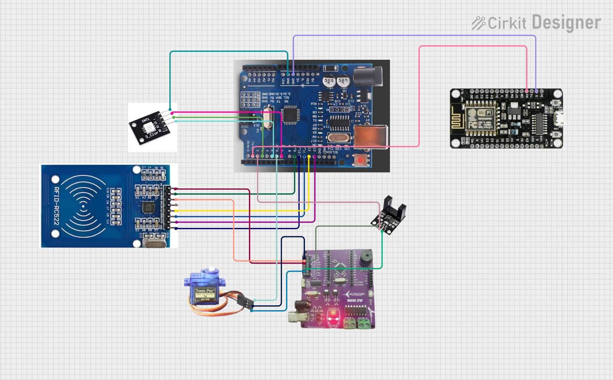
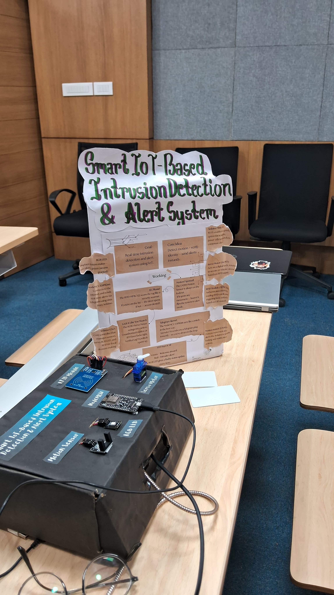
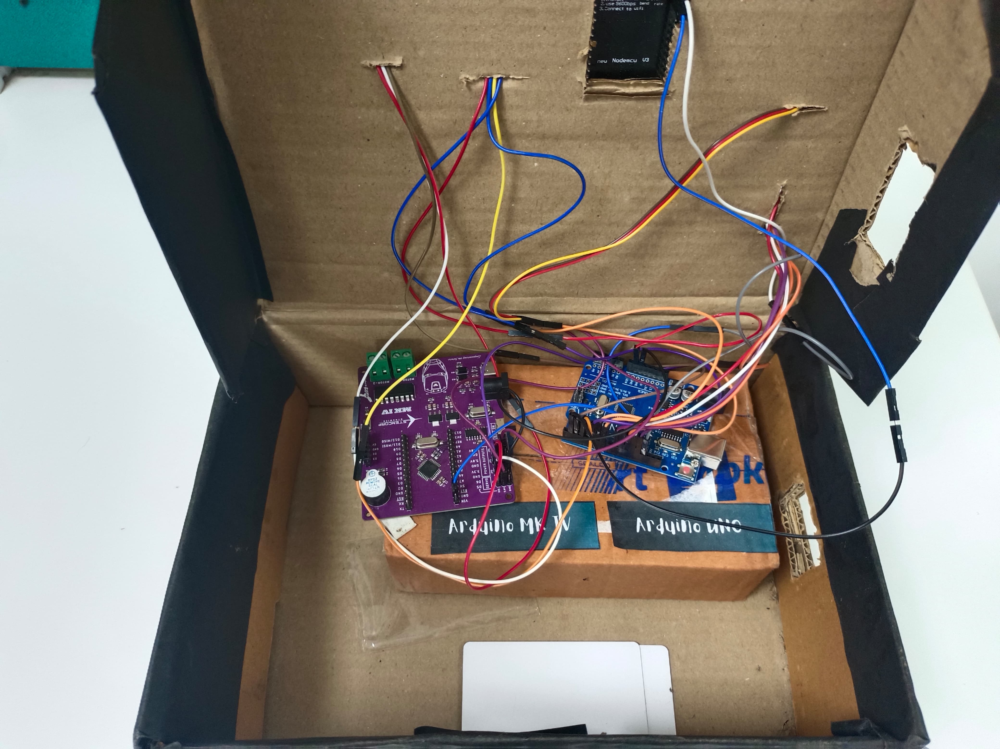
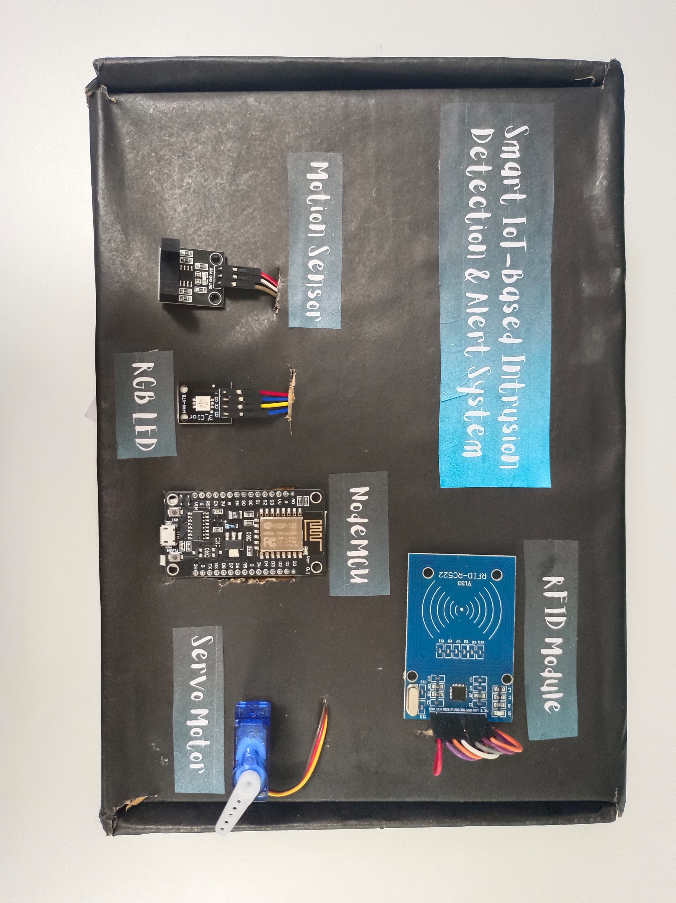

# Smart-IoT-Based-Intrusion-Detection-Alert-System
IoT-based intrusion detection &amp; alert system using NodeMCU, Arduino, RFID, Motion Sensors, and Telegram Bot API.
An intelligent and affordable security solution designed to monitor, detect, and respond to unauthorized access in real time. Undertaken at **Software Technology Park, Guwahati, Assam**.

## Introduction
Traditional security systems often lack real-time responses and smart automation. This project enhances security by integrating IoT components to provide instant intrusion detection, faster communication, and automated responses to potential threats. 

The system uses two Arduino UNO boards and a NodeMCU (ESP8266) to handle hardware and connectivity tasks. The Arduino manages sensor inputs, RFID authentication, and servo-controlled locking, while the NodeMCU connects to Wi-Fi to send real-time alerts via the Telegram Bot API.

---

## Objectives
* **Detects Intrusion & Lockdown:** An LM393 motion sensor detects unauthorized movement; the system immediately switches the RGB LED to red and locks the servo-controlled door.
* **Authenticate with RFID:** Arduino verifies user identity using the MFRC522 RFID module. Authorized tags unlock the door (Green LED), while unauthorized tags trigger alert mode.
* **Real-Time Telegram Alerts:** NodeMCU uses secure Wi-Fi to send instant intrusion and access notifications straight to your Telegram chat.

---

## Components Used

| Component | Specifications | Purpose |
| :--- | :--- | :--- |
| **NodeMCU (ESP8266)** | Wi-Fi enabled microcontroller (ESP-12E)| Sends real-time alerts via Telegram bot over Wi-Fi |
| **Arduino UNO (2x)** | ATmega328P-based microcontroller | Core control unit managing local operations |
| **RFID Module (MFRC522)** | 13.56 MHz RFID reader module| Authenticates authorized personnel via RFID tags |
| **Servo Motor** | SG90, 90° rotation | Simulates door lock mechanism (lock/unlock) |
| **LM393 Motion Sensor** | Infrared motion detector | Detects unauthorized physical movement |
| **RGB LED** | Common cathode, 3 PWM inputs | Indicates system state (Red: Alert, Green: Access Granted) |
| **Telegram Bot API** | Online messaging service | Delivers instant remote notifications |

---

## Working Principle
1. **Motion Detection:** The LM393 motion sensor continuously monitors the area for unauthorized movement.
2. **Auto-Lock Response:** Upon motion detection, the SG90 servo motor rotates to lock the door and the RGB LED turns red.
3. **RFID Authentication:** Scanning a valid RFID tag grants access (unlocks the door, turns RGB green), whereas invalid tags keep the system locked.
4. **Cloud Notification:** The NodeMCU transmits real-time event logs and status updates over Wi-Fi using the Telegram Bot API.
5. **System Coordination:** Communication between the Arduino UNO and NodeMCU is smoothly handled via the `SoftwareSerial` library.

---

## System Workflow 

---

---

## 📐 Circuit Diagram & Hardware Setup

### Circuit Diagram

### Hardware Enclosure & Setup
| External View / Presentation Board | Internal Circuit Wiring |
| :---: | :---: |
|  |  |

* **Circuit Box Overview:** 

---

## 📱 Real-Time Telegram Alerts

---

## Features
* **Dual-Controller Architecture:** Separates local hardware processing (Arduino) from wireless cloud communication (NodeMCU).
* **Instant Visual Feedback:** Color-coded RGB LED states (Red for intrusion/denied, Green for access granted).
* **Modular & Scalable:** Independent component layout makes future upgrades or maintenance easy.
* **Cost-Effective:** Built using accessible, off-the-shelf components ideal for homes, labs, and offices.

---

## Future Scope
* Integration of camera modules to capture and send photo/video evidence during security breaches.
* Advanced AI/Computer vision models to differentiate between humans and pets, reducing false alarms.
* Cloud-based database logging for historical access tracking and mobile app connectivity.
* Integration with smart voice assistants like Alexa or Google Assistant.

---

## Conclusion
The Smart IoT-Based Intrusion Detection & Alert System successfully bridges the gap between conventional security setups and modern IoT solutions. By combining local hardware defenses with instant remote notifications, it provides an efficient, low-cost, and reliable safeguard for personal spaces.
